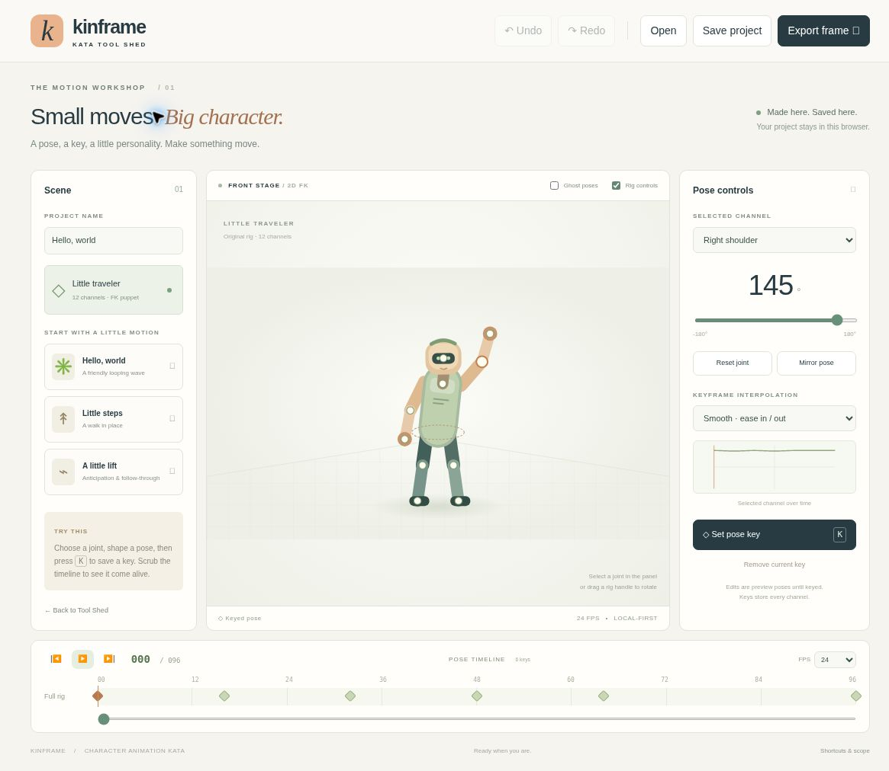

# Kata Kinframe

**Small moves. Big character.** An original character-animation workshop inspired by Maya's keyframe and rigging workflows. Pose a little traveler, build a timeline, and find the personality between the keys.

Part of [Kata Tool Shed](https://intrepion.github.io/tools/). Repository: `kata-app-inspired-by-maya-codex-dot`.



[View the 390px narrow layout](docs/screenshots/narrow.png). Screenshots are real localhost browser captures; the narrow image includes the centered test wrapper.

## Run locally

Node.js 18+ is required. There are **no runtime or package dependencies** to install.

```sh
npm run dev
```

Open `http://127.0.0.1:4313` in a browser. Do not open `index.html` directly or use `file://`. Choose another port with `PORT=4300 npm run dev` (PowerShell: `$env:PORT=4300; npm run dev`). The server also accepts `--host` and `--port` arguments.

```sh
npm run check   # Syntax checks and 10 model tests
npm run build   # Produces self-contained static dist/
```

Serve `dist/` through an HTTP static server. No external assets, accounts, or network APIs are required.

## Make your first motion

1. Start with **Hello, world**, **Little steps**, or **A little lift**.
2. Choose a channel in the pose inspector. Move its slider, or drag one of the visible rig handles. Root translation is controlled by the horizontal and lift sliders.
3. Choose a frame on the timeline and click **Set pose key**, or press **K**. Each key stores all 12 channels. Repeating the action replaces the current frame's key.
4. Pick Smooth, Linear, or Hold interpolation. It controls the segment after the selected key. A small channel curve shows the resulting timing.
5. Toggle ghost poses, scrub, or play the looping animation. Mirror a pose or reset one joint for a quick starting point.
6. **Save project** downloads editable `.kinframe` JSON. If your current pose is not keyed, saving asks to key it first. **Open** validates and restores a project.
7. **Export frame** downloads a clean SVG vector frame at 1800 × 1060, without rig controls or ghosts.

A preview pose is not a timeline key until you key it. Scrubbing samples the keyed timeline. Undo/redo retains up to 50 in-memory changes, including pose edits, keys, imports, and preset switches.

## Controls and accessibility

- **Space:** play/pause.
- **K:** set a full-pose key.
- **Left / Right:** move one frame.
- **Ctrl/⌘ Z / Ctrl/⌘ Shift Z:** undo/redo.
- **Ctrl/⌘ S:** save project.
- Standard labeled selects and range controls provide keyboard access to every pose channel.
- The viewport has optional pointer-operated rig handles. Root movement uses labeled sliders.
- Focus rings, semantic buttons, status announcements, and a dismissible help dialog are included.
- The narrow-screen layout stacks the scene and inspector without hiding editing controls.

## What this kata is

This is a working **2D forward-kinematic animation study**, not a Maya replacement or full 3D rigging application. It focuses on a fixed, original puppet with 12 channels, full-pose keys, interpolation, and immediate feedback. The floor is a drawn stage, not a 3D environment.

It does **not** include inverse kinematics, skinning, mesh editing, arbitrary skeletons, motion capture, animation layers, editable tangents, FBX, Maya `.ma/.mb` compatibility, rendered video, or audio. Timelines imported from valid projects may be 24–240 frames; presets use 96 frames. The UI does not resize duration. Playback supports 12, 24, 30, and 60 fps.

## Persistence and privacy

All project work remains in the browser. Autosave stores the latest keyed project under a dedicated local-storage key. Preview poses and undo history are not persisted. Storage can fail or be cleared; **download files for durable backups**. Presets and imports confirm replacement if there are changes since the last download. Changes remain undoable in the current session.

Imported files are capped at 1 MB. Validation checks the format/version, timeline bounds, unique sorted keyframes, interpolation values, and all channel ranges. Unknown fields are discarded. Project names are rendered as text, never executable HTML. No telemetry or uploads.

## Tests and documentation

- `npm run check`: Node model tests plus JavaScript syntax.
- `http://127.0.0.1:4313/tests/browser.html`: self-running browser interaction tests for controls, key replacement, interpolation, undo/redo, exports, playback, imports, invalid input, dialog dismissal, autosave, and 390px overflow.
- `tests/responsive.html`: 390px preview wrapper for narrow-layout QA.
- [Research and scope](docs/INSPIRATION.md).
- [Verification record](docs/QA.md).
- `app.json`: Tool Shed catalog metadata.

The browser test page deliberately mocks downloads and accepts its own replacement dialogs. It is a test harness, not the production app, and is excluded from the build. The harness resets only this app’s dedicated autosave key before and after its checks.

## License and inspiration

MIT. All code, rig geometry, artwork, and interface assets are original. Inspired by [Autodesk Maya](https://www.autodesk.com/products/maya/overview), without affiliation or endorsement. No proprietary code, models, logos, or file formats are included. The combined `.gitignore` covers Windows, macOS, Linux/Unix, editors, build outputs, dependency folders, local secrets, and test artifacts.

## Publishing

The GitHub Pages workflow checks and builds the app on pushes to `main` or manual dispatch, then deploys `dist/`. In repository Settings → Pages, choose **GitHub Actions** as the source. Deployment is separate from the local QA recorded above.


## Published app

Open [Kata Kinframe](https://intrepion.github.io/kata-app-inspired-by-maya-codex-dot/). The public repository uses GitHub Actions to verify and deploy `dist/` from `main`. See [QA notes](docs/QA.md) for local verification and known limits.
